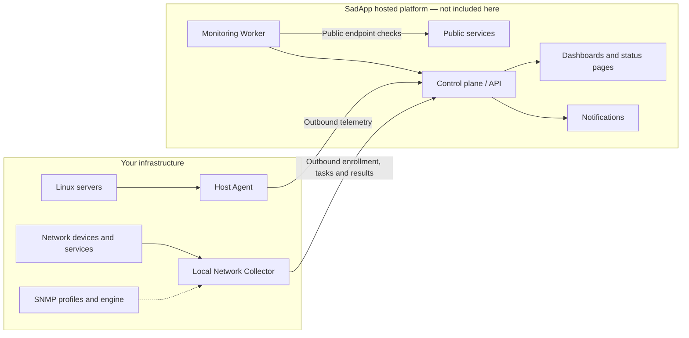

# SadApp – open components

[](https://github.com/s0c-org/sadapp/actions/workflows/ci.yml)
[](https://github.com/s0c-org/sadapp/releases)
[](LICENSE)

**Understand your infrastructure, from server health to private-network services.**

[SadApp](https://sadapp.org) brings host telemetry, network checks, SNMP discovery,
notifications, and status pages into one monitoring platform. This repository
contains its **open-source host agent, Local Network Collector, and SNMP tooling**:
inspect the code that runs in your environment, build it yourself, or contribute
device profiles.

**SadApp is in private alpha.** Access and features may change; this is not an
availability or production-readiness guarantee.

[Website](https://sadapp.org) · [Getting started](docs/getting-started.md) ·
[Installation](#installation) · [Documentation](#documentation) ·
[Releases](https://github.com/s0c-org/sadapp/releases)

## What you can monitor

- **Servers:** inventory, CPU and memory metrics, storage health, and supported
  Docker, SMART, and package telemetry through the Host Agent.
- **Private networks:** authorized LAN discovery and SNMP, ICMP, TCP, and REST
  checks through a Local Network Collector.
- **Network devices:** shared SNMP profiles and evaluation logic, with a
  reviewable vendor catalog.

The hosted platform adds dashboards, alert routing, notifications, and public
status pages. The control plane and hosted Monitoring Worker are proprietary
and are **not included in this repository**.

## System overview



The Host Agent reports on its own host. The collector performs explicitly
authorized checks inside your network; registering it alone does not enable
discovery or schedule checks. Configure its site, allowed networks, and tasks
in SadApp. See the [collector guide](docs/local-network-collector.md).

## Installation

### Before you start

- Obtain access to a SadApp workspace and create the appropriate invitation or
  enrollment token in its onboarding flow.
- Use a supported Linux system with **systemd** and **APT, DNF, or YUM**.
  Package availability depends on component, architecture, and release channel.
- Allow outbound HTTPS to SadApp and the package repositories. The collector
  also needs permission to reach the local targets you authorize.
- Use the command generated by your workspace for enrollment. Tokens are
  credentials: do not publish them in issues, screenshots, or logs.

The commands below download scripts first so you can review them before running
with root privileges. The installers configure the signed package repository,
install the component, and enable its systemd service. They pin the package
signing-key fingerprint; do not disable signature checks.

### Host Agent

```bash
curl -fsSLo install-agent.sh https://sadapp.org/install-agent.sh
less install-agent.sh
sudo sh ./install-agent.sh --channel stable --token '<invitation-token>'
```

Replace `<invitation-token>` with the Host Agent invitation from your workspace.
The installer requests interactive consent before making changes.
See [Host Agent setup](docs/host-agent.md) for enrollment and configuration.

### Local Network Collector

```bash
curl -fsSLo install-local-network-collector.sh \
  https://sadapp.org/install-local-network-collector.sh
less install-local-network-collector.sh
sudo bash ./install-local-network-collector.sh --channel stable
```

Enter the collector's one-time enrollment token at the hidden prompt. Use a
collector token, not a Host Agent invitation. Then assign its approved site and
monitoring tasks in SadApp.

### Verify the services

Run the commands for the component you installed:

```bash
systemctl status sadapp-host-agent.service --no-pager
journalctl -u sadapp-host-agent.service -n 50 --no-pager

systemctl status sadapp-local-network-collector.service --no-pager
journalctl -u sadapp-local-network-collector.service -n 50 --no-pager
```

Confirm enrollment and fresh telemetry in your workspace as well; an active
systemd service alone does not prove successful connectivity.
Windows Host Agent downloads are **experimental, unsigned alpha builds**;
they are not covered by the Linux installation instructions.

## Repository contents

| Path | What it is |
|---|---|
| [`host-agent/`](host-agent/) | Rust agent installed on Linux servers. Reports inventory, metrics, Docker/SMART/package state to the SadApp API. Shipped as signed `.deb`/`.rpm`. |
| [`local-network-collector/`](local-network-collector/) | Rust service for LAN discovery and SNMP/ICMP/TCP collection inside private networks. Pulls signed tasks from SadApp, uploads results. |
| [`snmp-profile-engine/`](snmp-profile-engine/) | Rust library for SNMP device detection and profile evaluation, shared by the collector and the hosted monitoring worker. |
| [`snmp-profiles/`](snmp-profiles/) | Vendor SNMP profile catalog (JSON) and its JSON Schema. Contributions welcome. |
| [`install/`](install/) | The installer scripts served at `https://sadapp.org/install-*.sh`. |
| [`docs/`](docs/) | Customer documentation. |

## Documentation

- [Getting started](docs/getting-started.md)
- [Host Agent](docs/host-agent.md)
- [Local Network Collector](docs/local-network-collector.md)
- [SNMP discovery and monitoring](docs/snmp.md)
- [Network checks](docs/network-checks.md)
- [Metrics and history](docs/metrics-and-history.md)
- [Notifications](docs/notifications.md)
- [Status pages](docs/status-pages.md)
- [Troubleshooting](docs/troubleshooting.md)

## Build

CI uses Rust **1.99.0** and Node.js **24**. Use those versions for a
reproducible starting point and keep the committed Cargo lockfiles.

```bash
cargo test --locked --manifest-path snmp-profile-engine/Cargo.toml
cargo test --locked --manifest-path local-network-collector/Cargo.toml
cargo test --locked --manifest-path host-agent/Cargo.toml
node snmp-profiles/scripts/check-profiles.mjs snmp-profiles/profiles
```

Packaging (`nfpm`) and cross-compilation notes live in each component's README.

## Releases and CI

Download accepted packages from [Releases](https://github.com/s0c-org/sadapp/releases).
Linux package promotion requires successful platform, native-package, and public
source CI checks. Version tags initiate signed package drafts; stable publication
still requires operator review. Verify the signed checksum manifest against an
independently trusted signing-key fingerprint before installing.
GitHub release assets do not imply that APT/RPM repositories were updated.

CI runs on a repository-scoped self-hosted runner for trusted main pushes and
version tags only. Pull requests do not execute automatically on that host;
maintainers review and validate contributions before merging.

## How this repository is maintained

This is a **read-only mirror** generated from SadApp's private source repository. Every sync is a single snapshot commit. Pull requests are welcome: maintainers review them here and apply accepted changes upstream, and the next sync then publishes them.

## Security

Please report vulnerabilities privately, see [SECURITY.md](SECURITY.md).

## License

[Apache License 2.0](LICENSE). "SadApp" and the SadApp logo are trademarks and are not licensed under Apache-2.0.
